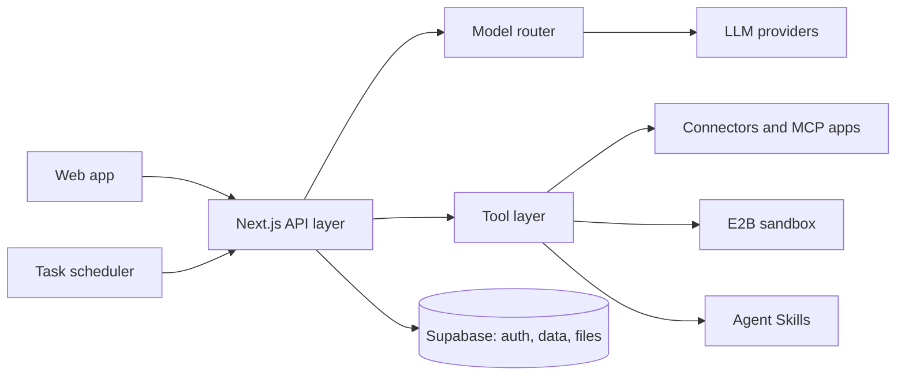

  
  
  
  

---

## 👋 About me

I'm Efezino Nathaniel, and I go by Zee. I'm a self-taught engineer and the Lead Engineer at **Zevn**. I build AI agents, automation and full-stack products, and I care about the unglamorous parts that make agents trustworthy: secure tool access, sandboxed execution, approval gates, and systems that recover when third-party APIs misbehave.

- 🛠️ **Building:** AI agents and automation, from client projects to my own products
- 📣 **Sharing:** the work, in public, on LinkedIn and X
- ⚡ **Strengths:** agent orchestration, MCP and connector integrations, scheduled autonomous tasks, security hardening, shipping fast
- 🌍 **Availability:** Remote (GMT+1) • open to collaborations and select AI engineering work

---

## 🧭 What I do

| | |
|---|---|
| 🤖 **AI agents and automation** | Agents that connect to real tools, run tasks on a schedule, and ask before doing anything sensitive |
| 🌐 **Full-stack web apps** | Next.js, React, TypeScript and Supabase products, from database design to polished interfaces |
| 🎥 **Building in public** | Honest build logs and product breakdowns on LinkedIn and X |

---

## 🚀 Featured project: Zevn

> Your AI delegate that actually gets work done.

Most AI tools answer questions. Zevn does the work: it connects to the tools you already use, plans the job, asks before anything sensitive, and then executes.

| | |
|---|---|
| 🔌 **30+ connectors and MCP apps** | Gmail, Calendar, Drive, Slack, GitHub, Notion, Stripe, Paystack, Flutterwave, Canva, Linear and more, all through OAuth |
| ⏱️ **Scheduled delegation** | Timezone-aware recurring tasks with automatic recovery, plus approval gates that pause for sensitive actions |
| 🧰 **Agent Skills** | Reusable skills the agent loads only when it needs them |
| 🔒 **Sandboxed execution** | Code and file generation in isolated E2B sandboxes (PDFs, decks, spreadsheets, documents) |
| 🛡️ **Security by design** | Per-command credentials, secret redaction, encrypted token storage and row-level security |

---

## 💻 Tech stack

**AI and agents**

  
  
  
  
  
  

**Backend and infrastructure**

  
  
  
  
  
  

**Languages and frameworks**

  
  
  
  
  
  

---

## 🎯 Right now

| | |
|---|---|
| **Role** | Lead Engineer @ Zevn |
| **Shipping** | Zevn private beta, with a clear roadmap and no feature creep |
| **Next up** | A mobile client for Zevn |
| **Learning** | Production-grade agent security and what makes people trust a delegate with real work |

---

## 🤝 Let's connect

I'm always up for talking agents, automation and building products. The best way to reach me is on [LinkedIn](https://linkedin.com/in/zino-nathaniel) or [X](https://x.com/Natheniel_ZEE), or by [email](mailto:nathanielzee50@gmail.com).

Let's build something intelligent together. 💙

